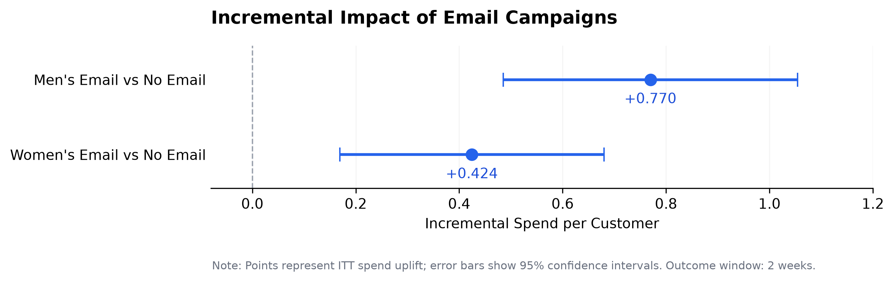
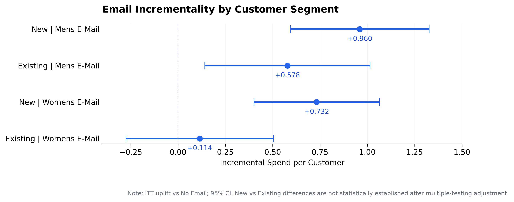
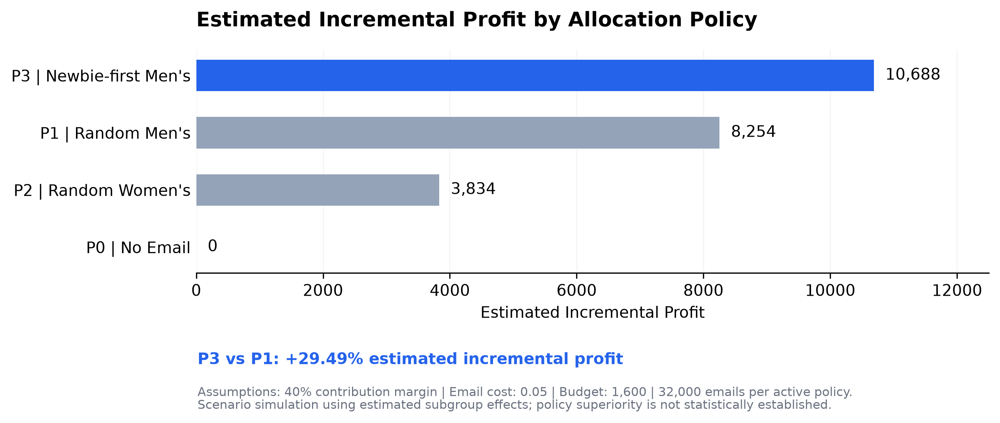

# Does Email Marketing Actually Drive Incremental Profit?

**From Conversion Rates to Incremental Profit**

*CRM Analytics Case Study | Randomized Experiment · SQL · Python · Customer Segmentation · Policy Simulation*

## 1. Executive Summary — The Business Decision

**Business problem.** A retail CRM team needs to decide whether to send marketing emails, which version to use, and which customers to prioritize under a limited budget. Optimizing conversion rates alone can misallocate resources toward customers who would have purchased anyway. The key decision is therefore not simply who converts, but **which campaign and targeting policy can generate additional business value**.

**Experiment at a glance.** A retailer randomly assigned 64,000 customers to three groups: **Men's Email** (promoting men's merchandise), **Women's Email** (promoting women's merchandise), or **No Email** (control group). These labels describe the products featured in the emails, **not the customers' genders**. Customer purchases and spending were then tracked over two weeks.

This randomized setup allows us to estimate how much additional spending each email campaign generated compared with sending no email.

**Data and approach.** Using Hillstrom's randomized experiment of 64,000 customers, I evaluated three connected decisions: (1) whether email increases spending beyond the no-email baseline, (2) whether customer characteristics provide credible targeting opportunities, and (3) how candidate allocation policies compare under hypothetical campaign economics. **KQ1–KQ2 use experimental outcomes; KQ3 is a policy simulation, not an observed profit result.**

| Key question | Main finding | Business decision & trade-off |
|---|---|---|
| **KQ1 · Does email generate additional spending?** | Relative to No Email, **Men's Email added an estimated 0.770 spend units per assigned customer** over two weeks. | **Prioritize Men's Email for further evaluation**, because it generated greater incremental spending than both No Email and Women's Email. However, actual profitability depends on campaign costs and margins. |
| **KQ2 · Is there a useful customer targeting opportunity?** | We compared **historical spending tiers, new/existing status, and past merchandise preferences**. New customers showed higher estimated uplift, but reliable differences in segment effects were not established. | **Explore New-customer-first targeting** because new customers showed consistently higher estimated uplift across both email variants, and lifecycle status is easy to identify and operationalize. However, the estimated advantage remains uncertain, so it is a testable hypothesis rather than a validated targeting rule. |
| **KQ3 · Which allocation might generate more incremental profit?** | Under the assumed campaign economics, **Newbie(New Customer)-first Men's Email generated 10,688 simulated incremental profit**, **29.49% above** Random Men's Email. | **Test Newbie-first against random allocation before rollout.** Although it showed higher simulated profit, adopting it directly risks overestimating the benefit due to uncertain subgroup effects and in-sample policy selection. A prospective experiment is needed to determine whether the targeting advantage holds in practice. |

**Recommendation.** Prioritize Men's Email for further campaign evaluation, as it demonstrated higher incremental spending than both No Email and Women's Email. However, the best targeting policy remains uncertain. Although Newbie-first Men's Email generated 29.49% higher simulated incremental profit than random Men's Email allocation, the subgroup evidence does not establish a reliable targeting advantage.

**Next step:** Verify actual campaign economics and run a prospective randomized comparison of Random Men's and Newbie-first Men's allocation, with an appropriate no-email holdout, before making a broader rollout decision.

## 2. Data Overview — What We Know and What We Assume

**Data Source.** This project uses the *MineThatData E-Mail Analytics and Data Mining Challenge* dataset, originally published by Kevin Hillstrom on March 20, 2008. The dataset contains 64,000 customers randomly assigned to three email campaign groups, with outcomes tracked over two weeks.

- **Original publication:** [Kevin Hillstrom — MineThatData E-Mail Analytics Challenge](https://blog.minethatdata.com/2008/03/minethatdata-e-mail-analytics-and-data.html)
- **Original CSV:** [Download the dataset](http://www.minethatdata.com/Kevin_Hillstrom_MineThatData_E-MailAnalytics_DataMiningChallenge_2008.03.20.csv)

**Experimental design.** The **Hillstrom / MineThatData Email Marketing Dataset** contains **64,000 rows**, one per customer, randomly assigned to three groups. The **No E-Mail group** provides a baseline for estimating the *intention-to-treat (ITT)* effect of email assignment. The dataset does not confirm that every assigned customer actually received, opened, or read an email.

| Experimental group | Customers | Role |
| --- | ---: | --- |
| Men's E-Mail | 21,307 | Email version A |
| Women's E-Mail | 21,387 | Email version B |
| No E-Mail | 21,306 | Control |
| **Total** | **64,000** | |

**Key field definitions.** Men's/Women's Email are **message variants, not recipient genders**. The `mens` and `womens` fields indicate **historical purchases of merchandise categories**, not customer gender. In particular, `history_segment` is derived from `history`; these are two representations of one underlying spending measure.

| Fields | Meaning | Use in analysis |
| --- | --- | --- |
| `segment` | Randomized email assignment | KQ1–KQ2: compare treatment with control |
| `spend` | Two-week customer spending, **including zeros** | Primary outcome: incremental spend per assigned customer |
| `conversion`, `visit` | Post-treatment purchase and visit outcomes | Secondary outcomes, **not targeting variables** |
| `history`, `history_segment` | Historical spend and seven original spend tiers | KQ2: past customer value |
| `newbie` | New (`1`) or existing (`0`) customer | KQ2: lifecycle-based segmentation |
| `mens`, `womens` | Historical merchandise purchase flags | KQ2: past category preferences |

**Segmentation design.** I selected **three pre-treatment dimensions** that correspond to meaningful CRM decisions: prior spending, customer lifecycle, and merchandise preference. Each was analyzed separately—**seven spending tiers, two new/existing groups, and three purchase-preference groups** (*Mens Only, Womens Only, Both*). Crossing them would create up to **42 subgroup combinations**, increasing sparse-cell uncertainty and opportunities for overly optimistic findings from repeated exploration.

**Data checks and limitations.**
- **Data validity:** Initial checks found **no SQL NULLs in the 12 fields** and no invalid values in the tested binary columns. Blank strings, categorical balance, and duplicate-row integrity were **not fully verified**.
- **Sparse outcomes:** **63,422/64,000 (99.10%)** customers had zero spend; only **578** purchased. Subgroup estimates can be sensitive to a few transactions.
- **Missing business inputs:** Actual contribution margin, email cost, campaign budget, creative/SKU details, and customer lifetime value are unavailable. **The source currency is not confirmed**, so monetary results retain the original data unit.

**What this supports—and does not.**
- **KQ1:** Randomized groups support a comparison of incremental spending versus No Email.
- **KQ2:** Pre-treatment customer attributes allow exploratory comparison of segment responses, **not automatic proof that targeting works**.
- **KQ3:** With real campaign economics unavailable, allocation results must be labeled **hypothetical profit simulations**.

## 3. Analytical Journey — Key Decisions and Human–AI Iteration

**How the work evolved.** The analysis progressed through repeated business questions, statistical checks, code execution, and review. I defined the decision problem, challenged the interpretations, and chose the evidence thresholds and scope. AI helped explore methods, develop SQL/Python analyses, and identify trade-offs. The following are **decision changes that affected the business recommendation**, not a list of AI tools.

### 3.1 KQ1 — Measure What Marketing Actually Adds

**Decision 1 — Change the success metric.** Conversion and observed revenue alone cannot distinguish marketing-caused purchases from organic demand. I therefore made **incremental spend per randomized customer** the primary metric: the difference in mean `spend` between each email group and No Email, **including customers who spent zero**. Conversion and visit remain secondary outcomes.

**Decision 2 — Check whether sparse spending changes the conclusion.** Because nearly all customers spent nothing, I tested whether the estimated effects remained credible using **bootstrap confidence intervals** and **Holm adjustment for the three primary spend comparisons**. The direction and statistical interpretation held. I did not attribute the differences to email creative or product price because the dataset cannot test those explanations. **Having established campaign-level uplift, the next question was whether customer segments should receive different treatments.**

### 3.2 KQ2 — Compare Three Targeting Ideas Before Selecting One

**Decision question.** If Men's Email creates incremental spending on average, **could targeting improve the allocation further?** Instead of assuming which customers would respond best, I compared three operationally meaningful segmentation ideas using characteristics available *before* the email was sent.

| Segmentation idea | What we learned | Decision |
| --- | --- | --- |
| **Historical spending (7 tiers)** | Some tiers showed large estimated uplift, but many had **very few actual purchasers**, making the results unstable. The overall interaction test did not meet the 5% threshold. | **Do not** choose recipients simply because a historical spending tier has a high uplift estimate. |
| **New vs existing (2 groups)** | **New customers had higher estimated uplift under both email variants.** The groups were large enough to be a practical starting point, though the effect differences were not firmly established. | **Carry forward as a practical exploratory hypothesis** for the KQ3 simulation. |
| **Past merchandise preferences (3 groups)** | Some preference groups looked promising, but comparisons did not provide reliable evidence of differences in email effects. | **Do not** build the first allocation policy around product preference. |

**Decision 3 — Test differences *between* segments, not just uplift *within* them.** A positive effect for new customers does not by itself prove they respond more strongly than existing customers. We checked **treatment-by-segment interactions** and adjusted nine specified comparisons (three Newbie, six purchase-preference) using **Holm**. **None remained significant after adjustment**; the historical-spending interaction was assessed separately (HC3 omnibus **p = 0.0527**). This means the available evidence **does not validate a differentiated targeting rule**, not that all customers are identical.

**Decision 4 — Select a hypothesis, not a winner.** New/existing status was chosen for KQ3 because it is interpretable, available before sending, and showed a consistent directional pattern—not because statistical testing proved it superior to other dimensions. We **stopped additional significance hunting** and treated **Newbie-first Men's Email** as an economic scenario requiring future validation.

### 3.3 KQ3 — Turn a Targeting Hypothesis into a Budget Decision

**Decision 5 — Move from spend to profit, with assumptions visible.** More incremental spending does not necessarily mean more profit. Since the dataset lacks real unit economics, I compared **four specified policies** using *estimated spend uplift × assumed contribution margin − assumed email cost*, subject to a budget cap. The model evaluates **candidate allocations**, not every possible targeting policy.

**Decision 6 — Keep allocation fixed when testing costs.** An early design considered changing send volumes whenever email cost changed. I instead held each policy's allocation fixed to isolate the effect of cost, then checked **budget feasibility separately**. This made an important business distinction visible: a policy may show positive *modeled* profit while **exceeding the available budget**. The budget is a cap, not an obligation to spend it all.

**Decision 7 — Do not turn a simulated winner into a live policy.** Newbie-first was selected and evaluated using the same experiment, which creates a risk of **in-sample selection bias (winner's curse)**. Its profit advantage is a reason to **design a policy-level experiment**, not to roll it out as a proven improvement.

## 4. Evidence — What the Results Show

### KQ1 — Incremental Spending



| Comparison | Spend uplift per assigned customer | 95% CI |
| --- | ---: | --- |
| Men's Email − No Email | **+0.7698** | [0.4851, 1.0545] |
| Women's Email − No Email | **+0.4244** | [0.1690, 0.6799] |
| Women's Email − Men's Email | **−0.3454** | [−0.6583, −0.0326] |

**Finding & Decision.** Both email variants generated positive incremental spending relative to No Email, with Men's Email showing the larger effect (+0.7698 per assigned customer). This supports prioritizing Men's Email for the next campaign evaluation rather than choosing based on observed conversion rates alone.

However, incremental spending is not incremental profit. The final rollout decision still depends on actual margins and campaign costs. The dataset also cannot explain which creative or product characteristics drove the difference.

### KQ2 — Why New vs Existing Was Explored



| Customer | Men's Email uplift | Women's Email uplift |
| --- | ---: | ---: |
| New (`newbie=1`) | **+0.9600** | +0.7323 |
| Existing (`newbie=0`) | +0.5780 | +0.1140 |

**Finding & Decision.** New customers showed higher estimated spending uplift under both email variants. For Men's Email, the estimated new-versus-existing difference was +0.3820, but its 95% CI [−0.1877, 0.9517] included zero.

This creates a practical targeting hypothesis, not a validated targeting rule. I therefore selected new/existing status for economic scenario testing because it is operationally interpretable and available before campaign assignment, while retaining uncertainty about the true difference in treatment effects.

### KQ3 — Simulated Incremental Profit



**Four policies under the baseline scenario:** 40% contribution margin, 0.05 cost per email, 1,600 budget cap, and 32,000 sends.P1 and P2 allocate the 32,000 sends **proportionally to the assumed new/existing audience mix**; their “Random” labels describe the *candidate policy*, not an actual random draw in the simulation. P3 prioritizes new customers for Men's Email. Each customer receives at most one email. The new/existing customer distribution (32,144 / 31,856) was verified against the 64,000 records in `data/hillstrom.csv`. The same counts are used in the KQ3 policy simulation.

| Policy | Emails sent | **Simulated** incremental profit |
| --- | ---: | ---: |
| P0 · No Email | 0 | 0.00 |
| P1 · Random Men's | 32,000 | 8,254.20 |
| P2 · Random Women's | 32,000 | 3,834.13 |
| P3 · Newbie-first Men's | 32,000 | **10,688.00** |

**Finding & Decision.** Under the assumed 40% contribution margin, 0.05 email cost, and 1,600 budget cap, Newbie-first Men's Email generated 10,688 in simulated incremental profit, 29.49% above Random Men's Email.

This makes Newbie-first a candidate for further testing, not an established superior policy. Its advantage relies on uncertain subgroup estimates and in-sample policy selection. Moreover, fixed allocations exceeding the budget at higher email costs are infeasible, even when modeled profit remains positive. The next decision is whether the potential upside justifies a prospective policy experiment.

## 5. Business Recommendations — From Evidence to Action

**Priority 1 — Evaluate Men's Email as the campaign candidate.**

The randomized experiment provides evidence that Men's Email increases average spending relative to No Email and outperforms Women's Email on the measured outcome. Before rollout, the CRM team should verify actual contribution margins, sending costs, and operational constraints to determine whether the spending uplift translates into incremental profit.

**Priority 2 — Validate Newbie-first targeting before adoption.**

Newbie-first Men's Email achieved the highest simulated profit, but the subgroup analysis did not establish a statistically reliable targeting advantage. I recommend a prospective randomized comparison of Random Men's and Newbie-first Men's allocation, with comparable eligible audiences, send volumes, and budgets. An appropriate no-email holdout should support incremental profit estimation.

**Decision criteria and trade-offs.**

- **Primary KPI:** Incremental profit per eligible customer, accounting for contribution margin and campaign costs.
- **Secondary metrics:** Incremental spending and conversion, to explain the profit outcome.
- **Constraints:** Campaign budget, audience eligibility, and send volume.
- **Decision rule:** Adopt Newbie-first targeting only if prospective evidence supports a meaningful economic advantage over random allocation.

**Limitations.** The experiment measures two-week outcomes, not long-term retention or customer lifetime value. Policy simulation results depend on assumed economics and estimated subgroup effects. No targeting policy has been prospectively validated in this case study.

## 6. Repository & Reproducibility

```text
hillstrom-crm/
├── data/          # Original and analysis-ready datasets
├── sql/           # Profiling and treatment-effect analysis
├── scripts/       # Statistical tests, policy simulation, plots
├── output/        # Exported CSV results and figures
├── .gitignore
└── README.md
```

**Recreate the figures.** With the required Python libraries installed, run these commands **from the repository root**:

```bash
python scripts/09_kq1_incrementality_plot.py
python scripts/10_kq2_segment_plot.py
python scripts/11_kq3_policy_plot.py
```

**What is reproducible.** Figure 2 reads `output/newbie_uplift_with_ci.csv`; Figures 1 and 3 plot previously computed values stored inside the scripts. The commands **regenerate the visualizations**, not the full SQL-to-policy analytical pipeline. A fully independent end-to-end run and pinned dependency environment have not yet been verified.
